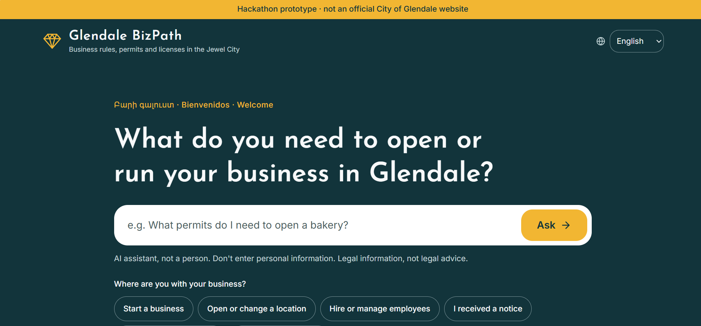

# Glendale BizPath



BizPath answers small-business owners' questions about the permits, licenses and rules that apply to them in Glendale, California, in their own language. Every answer is built only from a hand-checked set of City, County and State requirements, cites its source, and hands the owner off to the right City desk.

**Live:** https://glendale-bizpath.vercel.app

> Legal information, not legal advice. Not an official City of Glendale website.

The requirement data was compiled from public government pages on the dates shown with each entry. The official sources are the authority.

## Features

- **Ask in any language.** Answers stream back in the language of the question (or the language chosen in the header). Armenian and Spanish have a translated interface. Korean, Tagalog and Farsi get answers in the language; Farsi uses right-to-left layout.
- **"What applies to you" table.** Each answer lists the requirements that apply, who issues them, the fee, where to apply and the official source, with "Read the law" (the municipal code section) and "Why this applies to you".
- **Organized by the moment the owner is in.** Six lifecycle stages: start a business, open or change a location, hire employees, received a notice, renew or stay compliant, and find funding and help.
- **Business type guides.** Seven pages (food and drink, home-based, retail, personal services, offices, hotels, any other business) list every requirement in lifecycle order. They need no AI to read, and each page shows how complete its coverage is.
- **Notice decoder.** The owner pastes a notice they received. BizPath finds the rule it refers to, explains what it means and who to call, and quotes any date exactly as written in the notice.
- **Deadlines view.** One page lists every deadline in the corpus, such as registering as an employer within 15 days or the certificate renewal window.
- **Visit sheet.** A printable checklist of documents, fees and the Permit Services Center's address, hours and phone, built from the answer or guide the owner was reading.
- **Staff dashboard (`/staff`).** Reads live usage and feedback:
  - top questions and content gaps (questions with no verified source)
  - rules people find hard to understand, and flagged content
  - hand-offs to staff
  - breakdowns by language, business type and stage
- **Feedback on every answer and every step.** Thumbs up or down, with a reason ("Wrong or outdated", "Hard to understand", "Didn't answer my question", "Need a person").
- **Open data.** `/llms.txt` and `/corpus.json` are generated from the corpus.

## How it works

```
question ──► 1. EXTRACT (model)    language-neutral facts, topic, stage, intent, English version
         ──► 2. RULES  (plain code) lib/rules.ts selects corpus entries   ← the source of truth
         ──► 3. ANSWER (model)     explains ONLY those entries, cites [entry-id] on every fact
```

1. **Extract.** One model call turns the question into facts such as `serves_food` or `home_based`, plus a business type, lifecycle stage, topic and intent. Because the rules only see facts, a question in Armenian triggers the same obligations as the same question in English.
2. **Rules decide.** `lib/rules.ts` is a short, readable table of conditions and the corpus entries each one selects (for example, serving food selects the foodware and polystyrene rules). It also records which fact triggered each entry, which is what "Why this applies to you" shows. No model is involved in this step.
3. **The model only explains.** The answer call receives just the selected entries. Every factual sentence ends with its entry id, such as `[brc-fee]`. Requirements, fees, dates and contacts come from `data/corpus.json` and nowhere else. The table, contact card and "Read the law" links are rendered from that data, not from model text.
4. **Translate last.** The English corpus is the single source of truth. Answers are written in the owner's language from the English entries, and a "Show English" toggle shows the version that governs. Fees, phone numbers, URLs, code sections and official names stay unchanged.

The corpus has 15 entries, each tagged with the business types and lifecycle stages it applies to. Each entry carries a confidence level:

- **`verified`:** checked on the official page.
- **`link-only`:** the app shows only the title, issuer and link, never a fee or detail.
- **`recheck`:** the official page needs to be checked again.

There is no vector database. The whole corpus is small enough to audit by hand.

## Guardrails

These controls respond to the failures reported in NYC's MyCity business chatbot.

- **Grounded only.** The model may state only facts that appear in the entries the rules engine selected, each tagged with its source.
- **Consistent.** The same facts always select the same entries, so every asker gets the same requirements in every language.
- **Refusals are fixed text.** Requests for legal advice, help avoiding a rule, or anything off-topic get a short decline written in advance, not generated. Questions about wages or tips are declined too. Any rows shown with a decline are labelled "Related verified requirements (not an answer to your question)".
- **Honest fallback.** When no entry applies, the answer is "I don't have a verified Glendale source for that yet" with the Permit Services Center contact. The question is logged as a content gap for staff.
- **Human hand-off.** Every answer ends with a person to talk to and a visit sheet.
- **AI disclosure.** On first visit the owner is told this is an AI assistant, not a person, and must not be given personal information.
- **No personal data stored.** Only the English version of each question and its classification are logged, never the original text. Notice summaries leave out names and addresses. Feedback comments are never shown on the dashboard.
- **Machine translation is labelled.** Translated answers say that the English version governs.

## Stack

- Next.js 16 (App Router), React 19, TypeScript, Tailwind CSS 4
- Vercel AI SDK 7 with `@ai-sdk/anthropic`; Claude Haiku 5.5 (`claude-haiku-5-5`) for extraction and answers
- Upstash Redis (through the Vercel Marketplace) for usage and feedback logs
- Zod for structured extraction, SWR for the dashboard
- Hosted on Vercel; the interface was scaffolded with v0

## Run it locally

Requires Node.js 22 or newer and pnpm.

```bash
pnpm install
vercel env pull .env.local   # or create .env.local by hand with the variables below
pnpm dev                     # http://localhost:3000
```

Environment variables (in `.env.local`, which is never committed):

| Variable | Purpose |
|---|---|
| `ANTHROPIC_API_KEY` | Model calls for `/api/ask` and `/api/notice` |
| `KV_REST_API_URL`, `KV_REST_API_TOKEN` | Upstash Redis for usage and feedback. Optional: without them the app runs but nothing is saved |

Records are kept separate by environment. Production writes `bizpath:*` keys, while local and preview runs write `bizpath-local:*` and `bizpath-preview:*`, so testing never reaches the live dashboard.

`pnpm build` creates a production build.

## Project map

| Path | What it holds |
|---|---|
| `data/corpus.json` | The requirements: the only source of facts |
| `data/lifecycle-config.json` | Lifecycle stages, example questions, business types, coverage levels |
| `data/ui-strings.json` | Interface text in English, Armenian and Spanish |
| `lib/rules.ts` | The rules engine |
| `lib/grounded.ts` | The grounded answer step and system prompt |
| `app/api/ask`, `app/api/notice` | Question and notice routes (streamed NDJSON) |
| `app/api/feedback`, `app/api/handoff` | Feedback and hand-off logging; dashboard totals |

## Prepared before the event

Done before Jewel City Hacks 6.0 began:

- **Research:** the City, County and State pages behind each requirement, and the product plan.
- **Corpus data:** the requirements in `corpus.json`, each with its source URL, last-verified date and confidence level.
- **Interface text:** the English, Armenian and Spanish strings, plus the example questions per lifecycle stage.
- **Prompts:** the grounded-assistant system prompt and the notice-reading prompt.

**All application code was written at Jewel City Hacks 6.0.**

The Armenian and Spanish text is machine-translated and has not yet been reviewed by native speakers.

---

Legal information, not legal advice. Not an official City of Glendale website. Always confirm requirements with the City of Glendale before acting.

## License

The code is released under the MIT License. See [LICENSE](LICENSE).
